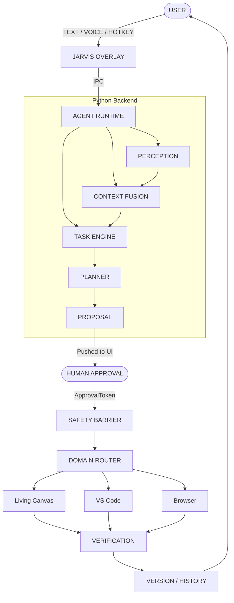

# JARVIS Architecture

JARVIS implements a rigorous bounded execution model. The UI runs in a transparent Electron/React renderer, while the brain operates as a local Python process.

## Architecture Diagram

## Subsystem Details
- **EventBus**: (`agent/runtime/event_bus.py`) All state transitions are idempotent and append-only.
- **Recovery**: (`agent/runtime/recovery.py`) A crash mid-execution resolves to `EXECUTION_UNCERTAIN`. JARVIS will NOT auto-retry without human re-grounding.
- **Audit**: (`agent/tasks/audit.py`) Extensive audit events (`AUDIT EVENT [PROPOSAL_CREATED]`) are emitted for tracing.
- **Provenance**: Phase 19 injected `WorkflowContextLink` objects that trace evidence extracted across applications.
- **Privacy Boundaries**: `ContextSanitizer` uses regex pattern matching over dictionary keys/values to redact potential passwords and API keys before they traverse execution environments.
